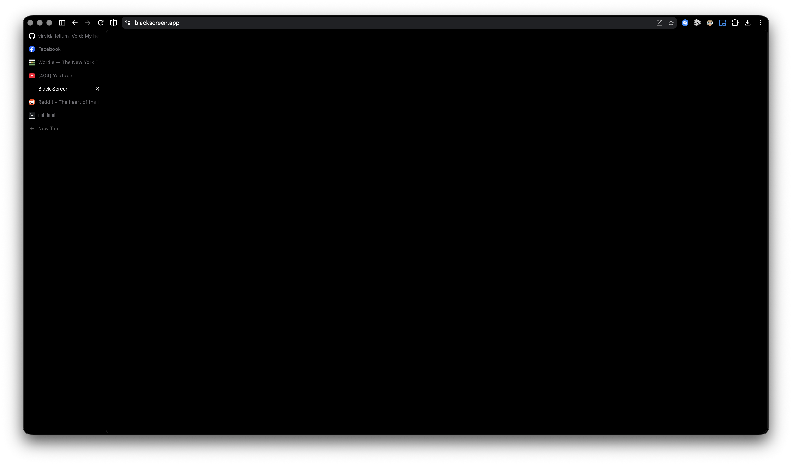

# Helium Void

A minimal, AMOLED-friendly true dark theme for [Helium Browser](https://helium.computer). Pure black frame, tabs, and backgrounds for a seamless void effect, with dimmed text for inactive tabs to keep the focus on your current work.

## What's Changed in this Fork

* **Seamless Void Background:** Changed the toolbar, inactive tabs, and New Tab Page (NTP) backgrounds from system dark gray (`#1c1c1e` / `[28, 28, 30]`) to pure black (`#000000` / `[0, 0, 0]`).
* **Dimmed Inactive Tab Text:** Updated the inactive tab text from bright white to a dimmed gray (`#6e6e73` / `[110, 110, 115]`) so the active tab remains clearly highlighted.

## Preview

## Installation

### Packed

1. Download the latest `Helium-Void-x.y.zip` from [Releases](../../releases)
2. Open `chrome://extensions` and enable **Developer mode** (top-right toggle)
3. Drag the zip onto the page
4. Done

Helium unpacks it into your profile, so the zip is safe to delete afterwards.

### Unpacked

If you want to edit the colors yourself:

1. Clone this repo, or unzip a release
2. Open `chrome://extensions` and enable **Developer mode** (top-right toggle)
3. Click **Load unpacked** → select the folder containing `manifest.json`

> [!IMPORTANT]
> Unlike the packed route, this one never copies the files — Helium re-reads that folder on every launch. **Move or delete it and the theme goes with it.** Keep it somewhere permanent, not Downloads or a temp folder you'll clear out later.

> [!NOTE]
> - Helium doesn't always apply theme changes on extension refresh. If colors aren't updating, remove the theme and re-add it via Load unpacked. If it still won't load, fully quit and relaunch Helium first.
> - Incognito windows are not affected — this is a Helium limitation, not a theme issue. Even the Void Theme from the Chrome Web Store has the same behavior.
> - Built on Manifest V3.

## License

Do whatever you want with it.
